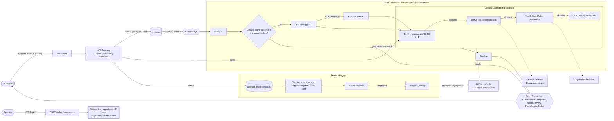

# Document Classification

Document classification decides what kind of document a file is, for example
a W-2, an invoice or a bank statement, so that it can be routed to the right
team or process and have the right fields read from it. Documents usually
arrive as PDFs, often scanned, and the class set is closed: every document is
either one of the declared classes, or `UNKNOWN`.

This repository implements classification as a cascade of interchangeable
classifiers, run cheapest first, and a serverless AWS service around it. The
text of each document is obtained once (the PDF text layer, or Amazon Textract
OCR for scanned pages) and shared by every tier. Each classifier either answers
with a calibrated confidence or abstains. The first confident answer wins, and
a document every tier abstains on resolves to `UNKNOWN` for human review.

> **This is sample code, not a production service.** It is provided to
> demonstrate an architecture and is not hardened for production use. Before
> you use it with real documents, review it against your own security,
> privacy, compliance and availability requirements, and run your own
> security review and load testing. Do not send sensitive personal data to a
> deployment you have not reviewed. See [Cost](#cost) before you deploy.
>
> The documents it is built for, such as tax forms, bank statements and
> invoices, routinely contain personal and financial data. If you process
> documents that contain payment card data, health information or EU personal
> data, you are responsible for the additional controls that PCI DSS, HIPAA or
> GDPR require. See the
> [AWS shared responsibility model](https://aws.amazon.com/compliance/shared-responsibility-model/)
> and the [AWS Compliance Center](https://aws.amazon.com/compliance/).

## What is implemented

| Component | What it does | ADR | Spec |
|---|---|---|---|
| Classifier contract and cascade | The shared interface and result type every tier implements, and the cascade that runs the tiers in order and stops at the first confident answer | [0001](adr/0001-classifier-cascade-and-contract.md) | [classifier-contract](specs/classifier-contract/) |
| Tier 1: char n-gram TF-IDF + logistic regression | A small trained model that runs in-process and tolerates OCR noise | [0003](adr/0003-char-ngram-tfidf-logistic-regression.md) | [char-ngram-lr](specs/char-ngram-lr/) |
| Tier 2: Titan embeddings, nearest class | Embeds the text with Amazon Titan and compares it to per-class exemplars. Needs no training, and a new class needs only a few labelled examples | [0004](adr/0004-titan-embedding-nearest-class.md) | [titan-nearest-class](specs/titan-nearest-class/) |
| Tier 3: SageMaker Serverless classifier | A fine-tuned model behind a serverless endpoint, for classes the cheaper tiers cannot separate. Enabled only for the classes evaluation says need it | [0005](adr/0005-sagemaker-serverless-classifier.md) | [sagemaker-classifier](specs/sagemaker-classifier/) |
| Serverless service | The API, orchestration, consumer onboarding and isolation, text acquisition, model lifecycle, and the Terraform module that packages it | [0006](adr/0006-serverless-service-shape.md)–[0010](adr/0010-packaging-terraform-module.md) | [platform](specs/platform/) |

Build order: the contract first, because every component implements it. Then
the platform tasks 1–6, which give a working tier 2 service. Tier 1 joins once
it has training data, and tier 3 is last, only for the class families
evaluation says need it.

| Read | For |
|---|---|
| `docs/overview.md` | The end-to-end design: text acquisition, the cascade, extraction, evaluation and operations |
| `docs/aws-architecture.md` | The AWS reference architecture: a shared serverless service for many consumers, with each tier mapped to AWS services |
| `docs/usage.md` | Using a deployment: the API, training and promoting models, adding tier 3, and removing a consumer |
| `adr/` | Why each method was chosen, the alternatives considered, and the consequences |
| `specs/` | What each component must do (requirements), how it is built (design), and the work to build it (tasks) |

## Architecture



Documents, text, jobs and models are stored per namespace in S3 and DynamoDB,
encrypted with one KMS key. Each tier answers or abstains, and the first
confident answer wins. See [docs/aws-architecture.md](docs/aws-architecture.md)
for the full reference architecture.

## Prerequisites

- An AWS account you can create IAM roles, KMS keys, Cognito user pools, API
  Gateway APIs and WAF web ACLs in, and AWS credentials for it.
- A Region where Amazon Bedrock, Amazon Textract and AWS AppConfig are
  available.
- **Model access to `amazon.titan-embed-text-v2:0` enabled in the Amazon
  Bedrock console** for that Region. Tier 2 cannot embed anything without it,
  and every document comes back `UNKNOWN`.
- [Terraform](https://developer.hashicorp.com/terraform/install) 1.10 or later,
  or [OpenTofu](https://opentofu.org/docs/intro/install/) 1.10 or later.
- Python 3.12 or later, with `pip`, `zip`, `rsync`, `tar` and `shasum` on the
  path.
- [AWS CLI v2](https://docs.aws.amazon.com/cli/latest/userguide/getting-started-install.html)
  and [awscurl](https://github.com/okigan/awscurl) for the onboarding call
  (`pip install awscurl==0.44`).

## Deploy

These steps deploy `examples/pooled`: no VPC, a module-created KMS key, and
no tier 3. A new consumer starts with tier 2 only, and returns `UNKNOWN` until
it has a tier 2 index. Tier 1 is added later by training. See
[docs/usage.md](docs/usage.md) for both.

Replace `ACCOUNT_ID` with your account ID. The Region defaults to `eu-west-1`,
in `backend.hcl.example` and in the example's `region` variable. To use
another Region, change it in the commands below, in `backend.hcl` and in
`terraform.tfvars`. Setting it in `terraform.tfvars` means every `apply` and
`destroy` uses the same Region without a `-var`.

1. Build the release artefacts into `dist/0.1.0/`:

   ```bash
   scripts/build_release.sh 0.1.0
   ```

2. Create a private, versioned S3 bucket for Terraform state:

   ```bash
   aws s3api create-bucket --bucket docclass-terraform-state-ACCOUNT_ID \
     --region eu-west-1 --create-bucket-configuration LocationConstraint=eu-west-1
   aws s3api put-bucket-versioning --bucket docclass-terraform-state-ACCOUNT_ID \
     --versioning-configuration Status=Enabled
   aws s3api put-public-access-block --bucket docclass-terraform-state-ACCOUNT_ID \
     --public-access-block-configuration BlockPublicAcls=true,IgnorePublicAcls=true,BlockPublicPolicy=true,RestrictPublicBuckets=true
   ```

3. In `examples/pooled`, copy `backend.hcl.example` to `backend.hcl` and set
   the bucket name and Region. Copy `terraform.tfvars.example` to
   `terraform.tfvars` and set the Region, then deploy:

   ```bash
   cd examples/pooled
   terraform init -backend-config=backend.hcl
   terraform apply
   ```

   `terraform.tfvars` also sets `log_retention_days`, browser upload origins
   (`cors_allowed_origins`, none by default) and tier 3. To add tier 3, set
   `tier3_endpoints` (a map of namespace to SageMaker image, model artefact,
   memory and concurrency). You bring the model: see
   [Tier 3](docs/usage.md#3-tier-3-bring-your-own-model).

4. Onboard a consumer. The admin route uses IAM authentication, and the
   response is the only time the client secret and API key are returned:

   ```bash
   awscurl --service execute-api --region eu-west-1 -X POST \
     -d '{"name": "team-a", "classes": ["W2", "INVOICE", "BANK_STATEMENT"]}' \
     "$(terraform output -raw admin_url)"
   ```

   The consumer's first configuration rolls out with the module's gradual
   AppConfig strategy: about 10 minutes, then a 15-minute bake. Until it
   reaches a caller, sync `/v1` calls return 503
   `{"error": "namespace_not_configured"}`, and async jobs retry for about 13
   minutes before they fail.

5. Get a token with the client credentials grant and call the API.
   `CLIENT_ID`, `CLIENT_SECRET` and `API_KEY` are the `client_id`,
   `client_secret` and `api_key` fields of the onboarding response:

   ```bash
   TOKEN=$(curl -s -u "CLIENT_ID:CLIENT_SECRET" -d grant_type=client_credentials \
     "$(terraform output -raw token_endpoint)" | python3 -c 'import json,sys; print(json.load(sys.stdin)["access_token"])')
   curl -s -X POST "$(terraform output -raw api_url)/classify" \
     -H "Authorization: $TOKEN" -H "x-api-key: API_KEY" -H "Content-Type: application/json" \
     -d '{"pages": [{"number": 1, "text": "Form W-2 Wage and Tax Statement"}]}'
   ```

   The answer is `UNKNOWN` until the consumer has a trained model. See
   [docs/usage.md](docs/usage.md) for the full API, async jobs, and how to
   train and promote models.

## What a run looks like

Values are shortened, and ids are replaced with placeholders.

**`terraform apply`** ends with the stack's outputs:

```text
Apply complete! Resources: 159 added, 0 changed, 0 destroyed.

Outputs:

admin_url = "https://API_ID.execute-api.eu-west-1.amazonaws.com/live/admin/consumers"
api_url = "https://API_ID.execute-api.eu-west-1.amazonaws.com/live/v1"
artefact_bucket = "docclass-artefacts-ACCOUNT_ID"
data_bucket = "docclass-data-ACCOUNT_ID"
event_bus_arn = "arn:aws:events:eu-west-1:ACCOUNT_ID:event-bus/docclass-events"
tier3_endpoints = {}
token_endpoint = "https://docclass-ACCOUNT_ID.auth.eu-west-1.amazoncognito.com/oauth2/token"
training_state_machine_arn = "arn:aws:states:eu-west-1:ACCOUNT_ID:stateMachine:docclass-training"
```

**Onboarding** returns the credentials once. Keep `client_secret` and
`api_key`; they are not shown again:

```json
{"namespace": "team-a", "created": true, "client_id": "CLIENT_ID", "client_secret": "CLIENT_SECRET",
 "api_key": "API_KEY", "api_key_id": "API_KEY_ID", "usage_plan_id": "USAGE_PLAN_ID"}
```

**Classify, before training.** A new namespace has only tier 2, with no
index, so the cascade abstains:

```json
{
  "decision": {"class_id": "UNKNOWN", "confidence": 0.0, "accepted": false, "method": "cascade",
               "model_version": "team-a-initial", "taxonomy_version": "tx-1", "scores": {},
               "reason": "titan_nn: not provisioned: index", "metadata": {}},
  "attempts": [{"tier": "titan_nn", "decision": {"class_id": "UNKNOWN", "accepted": false,
                "reason": "not provisioned: index", "...": "..."}, "error": null, "elapsed_ms": 0.125}],
  "doc_hash": "b69c4fc9...", "taxonomy_version": "tx-1", "config_version": "team-a-initial"
}
```

**Classify, after training.** Once a namespace has a trained tier 1, a
document it recognises is answered by that tier on its own. The values below
show the shape of the answer:

```json
{
  "decision": {"class_id": "W2", "confidence": 0.97, "accepted": true, "method": "char_ngram_lr",
               "model_version": "ngram-<content hash>", "taxonomy_version": "tx-1",
               "scores": {"W2": 0.97, "INVOICE": 0.02, "BANK_STATEMENT": 0.01},
               "reason": null, "metadata": {"centroid_similarity": 0.92}},
  "attempts": [{"tier": "char_ngram_lr", "decision": {"...": "the same decision"}, "error": null,
                "elapsed_ms": 0.8}],
  "doc_hash": "b69c4fc9...", "taxonomy_version": "tx-1", "config_version": "team-a-initial+ngram-..."
}
```

`attempts` lists every tier that ran, so an `UNKNOWN` says why each tier
abstained.

**An async job**, polled with `GET /v1/jobs/{id}`, moves through `Pending`,
`AcquiringText` and `Classifying` to `Completed` (accepted) or `NeedsReview`
(`UNKNOWN`), and then carries the same result:

```json
{"jobId": "JOB_ID", "status": "Completed", "createdAt": 1792040000, "updatedAt": 1792040012,
 "docHash": "b69c4fc9...", "result": {"decision": {"class_id": "W2", "accepted": true, "...": "..."}}}
```

## Train on your own documents

To get real answers rather than `UNKNOWN`, train a namespace on labelled
documents of your own:

1. Put the PDFs in one folder per class, named by class id, for example
   `my-documents/W2/` and `my-documents/INVOICE/`. Aim for at least 10 per
   class and about 100 in total: tier 1 needs 10 per class, and the tier 2
   index stays disabled with fewer than about 100 exemplars.
2. Onboard a namespace with those classes, as in Deploy step 4, and wait for
   its configuration to roll out.
3. Upload them as exemplars and labels. From the repository root, with the
   `aws` and `pdf` extras installed (`pip install -e '.[aws,pdf]'`):

   ```bash
   python3 scripts/make_exemplars.py my-documents --namespace team-a \
     --bucket "$(terraform -chdir=examples/pooled output -raw data_bucket)"
   ```

   Every fifth document per class is held out and listed in `holdout.json`.
4. Follow [Train and promote](docs/usage.md#2-from-unknown-to-real-answers-train-and-promote)
   for tiers 2 and 1.
5. Classify the held-out documents as [async jobs](docs/usage.md#async-jobs),
   and compare each result's `class_id` with its class.

## Clean up

The module protects stored data, so `terraform destroy` alone fails. In
`examples/pooled`, with the same Region:

1. Remove each consumer, as in
   [Removing a consumer](docs/usage.md#4-removing-a-consumer). Onboarding
   creates its API key, usage plan, app client, alarm and AppConfig resources
   outside Terraform, so `destroy` does not remove them.
2. Turn off deletion protection on the `docclass-consumers`,
   `docclass-decisions` and `docclass-jobs` DynamoDB tables and on the
   `docclass-consumers` Cognito user pool:

   ```bash
   for t in docclass-consumers docclass-decisions docclass-jobs; do
     aws dynamodb update-table --table-name "$t" --no-deletion-protection-enabled
   done
   aws cognito-idp list-user-pools --max-results 60 \
     --query "UserPools[?Name=='docclass-consumers'].Id" --output text
   ```

   Then turn off deletion protection on that user pool in the Amazon Cognito
   console.
3. Empty the `docclass-data-ACCOUNT_ID` and `docclass-artefacts-ACCOUNT_ID`
   buckets, including all object versions, in the Amazon S3 console.
4. Destroy the stack, then delete the state bucket when you no longer need it:

   ```bash
   terraform destroy
   ```

The KMS key is scheduled for deletion after the AWS waiting period rather than
deleted at once.

## Cost

You are responsible for the cost of the AWS resources you deploy. The pooled
example has no idle compute: Lambda, Step Functions, API Gateway, DynamoDB
(on-demand), S3, Textract and Bedrock are charged per use. The resources that
cost money while idle, and the per-use charges to plan for, are:

| Resource | When | Approximate monthly cost |
|---|---|---|
| AWS WAF web ACL with 3 rules | Always | $8 plus requests |
| KMS customer-managed key | When the module creates the key | $1 plus requests |
| CloudWatch alarms | 7, plus 1 per consumer | $0.10 per alarm metric. The 3 coverage alarms and the failure-rate alarm use 2 metrics each |
| CloudWatch Logs storage | Logs kept for `log_retention_days` (default 365) | Per GB stored. For short tests, set `log_retention_days` lower in `terraform.tfvars` |
| Cognito machine-to-machine app clients | 1 per consumer | See [Cognito pricing](https://aws.amazon.com/cognito/pricing/) |
| VPC interface endpoints | `vpc_mode = "byo"`: 16 per subnet AZ | About $7.30 each per AZ, roughly $230 for two AZs |
| SageMaker Serverless endpoints | `enable_tier3 = true` | Per inference, no idle charge |
| SageMaker training job | Each tier 1 (`ngram`) training run | One `ml.m5.large`, per second of run time, at most an hour per run |
| Amazon Textract | Async jobs, for each page without a text layer (at most the first 2 pages) | Per page |

Per-document cost depends mostly on Textract pages for scanned documents and
on Bedrock embedding tokens. Check current prices in the
[AWS Pricing Calculator](https://calculator.aws/), and destroy the stack when
you finish testing.

## Dependencies

This repository contains no third-party code. Its dependencies are installed
from PyPI by `pip`, or into the Lambda package by `scripts/build_release.sh`,
on your machine:

| Package | Version | Used for | License |
|---|---|---|---|
| [NumPy](https://pypi.org/project/numpy/) | 2.2.6 | Tier 1 scoring and tier 2 index (library and Lambda package) | BSD-3-Clause |
| [pypdf](https://pypi.org/project/pypdf/) | 6.21.4 | Reading the PDF text layer (`pdf` extra and Lambda package) | BSD-3-Clause |
| [boto3](https://pypi.org/project/boto3/) | 1.43.108 | AWS calls (`aws` extra; provided by the Lambda runtime) | Apache-2.0 |
| [scikit-learn](https://pypi.org/project/scikit-learn/) | 1.7.2 | Training tier 1 (`train` extra and the SageMaker training job) | BSD-3-Clause |
| [awscurl](https://pypi.org/project/awscurl/) | 0.44 | The SigV4-signed onboarding call | MIT |
| [PyTorch](https://pypi.org/project/torch/) | 2.14.1 | Training a tier 3 model, optional | BSD-3-Clause |
| [Transformers](https://pypi.org/project/transformers/) | 5.20.2 | Training a tier 3 model, optional | Apache-2.0 |
| [Accelerate](https://pypi.org/project/accelerate/) | 1.15.0 | Training a tier 3 model, optional | Apache-2.0 |

Each pulls in further packages. A tool such as
[pip-licenses](https://pypi.org/project/pip-licenses/) lists them with their
licenses.

Although this repository is released under the MIT-0 license, its tier 3
training tools (PyTorch and Transformers) use the third-party tqdm, regex and,
on Linux x86_64, NVIDIA CUDA packages, whose licensing includes MPL-2.0,
CNRI-Python and NVIDIA's proprietary license. Its AWS tooling
(`requests`, used by awscurl) uses the third-party certifi package, which is
licensed under MPL-2.0.

## Spec-driven development

**No code without a spec.** Every component is built in this order, and each
step is a reviewable change:

```
1. ADR           adr/NNNN-*.md               why: decision, alternatives, consequences
2. Requirements  specs/<c>/requirements.md   what: numbered, testable acceptance criteria
3. Design        specs/<c>/design.md         how: interfaces, data, algorithms, errors
4. Tasks         specs/<c>/tasks.md          plan: ordered tasks, each traced to criteria
5. Code          implements the criteria     nothing beyond what a criterion asks
```

The rules that keep this honest:

1. **Every acceptance criterion has an ID** (for example `NGRAM-AC-03`), so
   tasks, code reviews and commits can refer to it.
2. **Every task cites the criteria it satisfies.** A task that cites none is
   either missing a requirement or is not needed.
3. **Behaviour changes start in the spec.** Update `requirements.md` first,
   then the code, in one change. A change to the code alone is a defect, even
   if the code is right.
4. **Decisions that change direction get a new ADR** that supersedes the old
   one. Accepted ADRs are not edited, apart from their status line.
5. **Specs have a status:** `Draft` → `Approved` → `Implemented`. Implementation
   starts only once the spec is `Approved`.

See `specs/README.md` for the requirement format.

## Security

If you discover a potential security issue in this project, notify AWS/Amazon
Security via our
[vulnerability reporting page](http://aws.amazon.com/security/vulnerability-reporting/).
Please do **not** create a public GitHub issue. See
[CONTRIBUTING](CONTRIBUTING.md#security-issue-notifications) for more
information.

## License

This library is licensed under the MIT-0 License. See the [LICENSE](LICENSE)
file.
